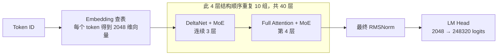
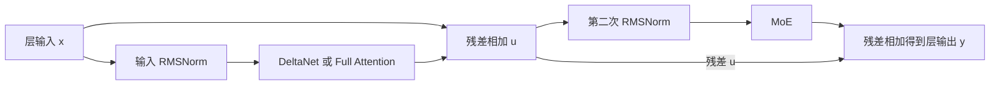
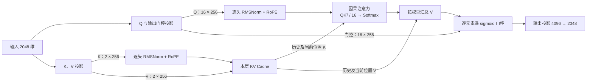
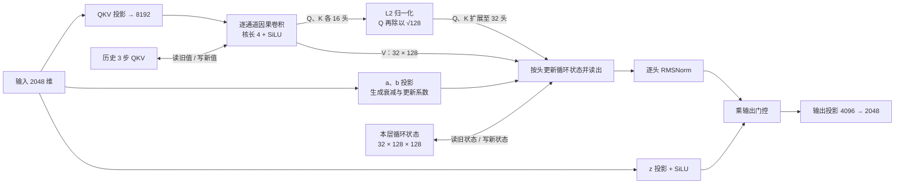
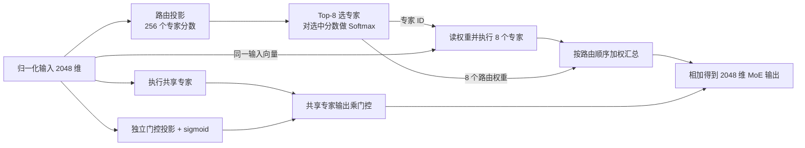
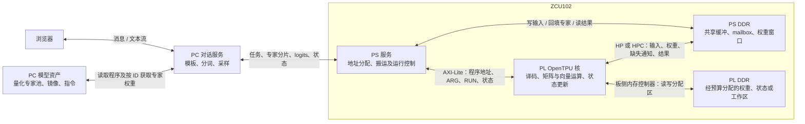
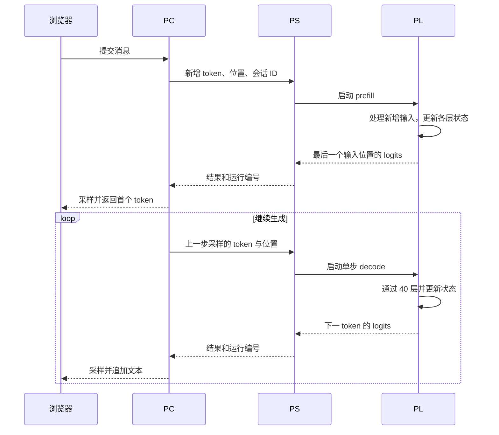
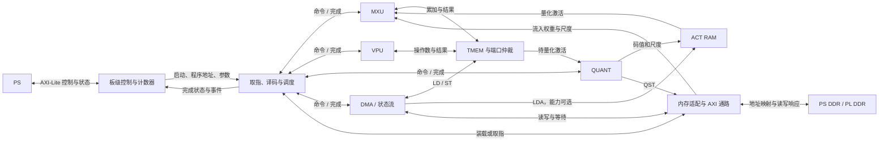

# HSA-MoE-ACC v1 顶层设计 Spec

## 1. 设计目标与任务拆分

在一块 **AMD ZCU102** 上，用 **Qwen3.6-35B-A3B 的真实权重**完成全 40 层文本推理。PL 执行 prefill 和 decode 中的各层计算，以及最终归一化与词表投影。PC 负责对话、分词、采样及专家权重存储，PS 负责管理 PL 和回填。Embedding 表可由 PC 提供所查行，PL 接收该行进入第一层。

首版验收为单用户、batch 1、总上下文 512 token，浏览器至少完成两轮有关联的回答。用相同的量化权重、输入和 greedy 采样，与 ISA 参考比较专家索引、关键状态、logits 和输出 token，并提供对应请求的 PL 完成记录。两轮之间，token 位置、KV Cache 和 DeltaNet 状态须对应同一段输入历史。视觉输入、MTP 和并发服务留待后续版本。

| 任务 | 具体工作与交付 | 前置条件 |
|---|---|---|
| T1 模型与 ISA 参考 | 锁定模型 revision 和量化配置，导出权重布局、各类层的状态尺寸与参考张量。用真实权重跑通全 40 层短文本路径，记录路由索引与 logits | 起点 |
| T2 板级通路 | 建立 PS 寄存器控制和 PL 到 DDR 的读写通路。交付地址窗口、对齐约束、实际可分配容量、DDR 与 PC–PS 搬运测试 | 与 T1 并行，可先用合成数据 |
| T3 基础 PL 执行核 | 适配取指、调度、TMEM、MXU、VPU、QUANT 和 DMA。按 T1 的数据格式、T2 的地址窗口验证单条指令和两种层的 RTL 执行 | T1 的格式和参考向量，T2 的接口约束 |
| T4 专家流送 | 用 T1 的真实路由轨迹定缓存规模。接通 PL 缺失通知、PS 回填和继续执行，交付命中、缺失与超时记录 | T1 的专家布局与路由；T2 的容量和带宽；T3 的等待与访存通路 |
| T5 全模型上板 | 按两种层分别做板端对照，再运行 40 层 prefill 和逐 token decode。检查 logits、缓存可见性和会话状态 | T3、T4 |
| T6 网页联调 | 复用 PC 聊天入口，接入实板后端。演示两轮对话并关联网页请求、板端计数和输出 token | 接口开发可与 T3 并行，最终验收依赖 T5 |

T1 和 T2 出结果后，先确定板上常驻数据、专家槽位置及 PC–PS 链路，再冻结 T4 的缓存协议。首轮性能优化以 T5 的整网基线为准，单算子原型可先用 T1 和 T3 的数据验证。

## 2. 模型结构与存储预算

### 2.1 文本网络与两种层

文本主干共 40 层，按 **3 层 Gated DeltaNet + 1 层 Gated Full Attention** 重复 10 次。每层都有 MoE。两种层的差别在第一个子层，第二个子层都由归一化、MoE 和残差相加组成。模型隐藏维度为 2048，词表为 248320，Embedding 和 LM Head 使用独立权重。[Qwen 配置](https://huggingface.co/Qwen/Qwen3.6-35B-A3B/blob/main/config.json) · [固定上游的配置快照](../third_party/opentpu/tools/pf500_models/Qwen3.6-35B-A3B/config.json) · [OpenTPU 模型参考](../third_party/opentpu/opentpu/llm/qwen35.py)

两类层都采用两次残差相加。RMSNorm 对每个 token 的隐藏维计算均方，用 r = 1/√(mean(x²)+ε) 缩放输入，再逐元素乘增益。模型配置中 ε 为 10⁻⁶。

#### Full Attention 层

下图展开通用层图中的混合器。其输出经第一条残差送入第二次 RMSNorm 和 MoE。

**Full Attention** 使用 16 个 Q 头和 2 个 KV 头，每组 8 个 Q 头共享一个 KV 头。Q、K 各头只有前 64 维应用 RoPE。每次写入当前位置的 K、V，只读取因果范围内的数据。分块 Softmax 跨块维护行最大值、归一化和输出累加。[注意力实现](../third_party/opentpu/opentpu/kernels/attention.py)

#### Gated DeltaNet 层

该层沿用相同的残差和 MoE 结构，混合器内部更新固定大小的循环状态与卷积历史。

**Gated DeltaNet** 每个 Q/K 头对应两个状态更新头，头维均为 128。以单头列向量表示，先计算衰减状态 `Sd = exp(g) × Sprev`，再算 `δ = β × (v − Sdᵀk)` 和 `Snew = Sd + kδᵀ`，输出为 `Snewᵀq`。`g = −exp(A_log) × softplus(a + dt_bias)`，`β = sigmoid(b)`。跨 token 保存循环状态和卷积历史。[DeltaNet 算子](../third_party/opentpu/opentpu/kernels/deltanet.py)

#### 两种层共用的 MoE

**MoE** 每个专家将同一个 2048 维输入分别投影为 `gate[512]` 和 `up[512]`，计算 `SiLU(gate) × up` 后投影回 2048 维。共享专家同为 512 中间维，其门控独立于 Top-8。缓存和调度按选中的逻辑专家执行，合并遵循固定累加顺序。[路由与专家实现](../third_party/opentpu/opentpu/llm/moe.py)

### 2.2 存储预算

ZCU102 标配 4 GiB PS DDR 和 512 MiB PL DDR，分属两个控制器。PS 可分配容量须扣除系统占用。下表的专家槽按固定上游的 FP4、D=128、WG=8 布局估算，板级参数改变时用实际打包清单重算。[ZCU102 板卡手册](https://docs.amd.com/api/khub/documents/rt6tROKcAceWoROXFPMY5w/content) · [上游板端镜像记录](../third_party/opentpu/docs/bcu1525_wg.md)

| 对象 | 预算方法 | 当前估算与用途 |
|---|---|---|
| 完整镜像 | 权重、尺度、对齐及运行区，按打包清单 | 上游 35B 镜像为 17,903 MiB，约 17.48 GiB |
| 单个路由专家 | 3 × 2048 × 512 参数；FP4 码值、尺度及对齐 | 3,145,728 参数，专家槽 1,691,648 B（约 1.61 MiB） |
| 全部路由专家 | 40 × 256 × 单槽字节数 | 16.13 GiB，另计共享专家和其他权重 |
| 上游按层缓存下限 | 40 层 × 每层至少 8 槽 | 516.25 MiB，已超过整个 PL DDR |
| 每个 decode token 的专家读取 | 40 × 8 × 单槽字节数 | 516.25 MiB，按每个激活专家读取一份槽大小估算 |
| PC 到板的专家回填 | 对各层实际缺失槽求字节数之和 | 全冷全缺失示例为 516.25 MiB/token。用实际路由轨迹求冷、暖缓存流量 |
| KV Cache | 上游 INT8 K/V 和尺度为 10,480 × 上下文长度 B | 512 token 约 5.12 MiB；FP32 K/V 为 20 MiB，未计额外对齐 |
| DeltaNet 状态 | 30 × 32 × 128 × 128 × 每元素字节数 | FP32 60 MiB，ST16 30 MiB；FP32 卷积历史另约 2.81 MiB |
| Embedding、LM Head | 每张表 248320 × 2048 参数，分别计入 | 各 INT8 裸码 485 MiB、FP16 裸码 970 MiB，另计尺度 |
| 其余板端空间 | 常驻权重、程序、mailbox、激活、DMA 缓冲及系统预留 | 打包和分配后列出各区的实占、起止地址及余量 |
| 片上空间 | 按 TMEM、ACT RAM、FIFO 的深度、端口数与副本计算 | ZU9EG 无 UltraRAM，按 BRAM 布局重新评估 |
| PC 内存和磁盘 | checkpoint、专家池、转换临时文件及映射缓存 | 记录打包过程峰值内存与磁盘实占 |

### 2.3 部署路线

| 路线 | 权重放置与执行 | 采用条件 |
|---|---|---|
| A 全权重驻留 | 整个镜像在板端，PL 直接读取 | 当前镜像超过标准 ZCU102 容量。内存扩容后重新预算 |
| B 专家按需流送 | PC 保存专家池，PS 将缺失专家填入 PL 可读的槽，PL 执行全部文本层 | 单板首选路线。用 PS DDR 权重窗口或重构的槽池解决容量问题。T1/T2 确认常驻区能放下，再用真实路由、实际缺失字节和链路吞吐评估交互延迟 |

## 3. 系统架构与数据流

### 3.1 PC、PS、PL 分工

| 环节 | 数据和控制顺序 |
|---|---|
| 装载 | PC 提供与 target 匹配的程序、权重布局和打包格式。PS 分配 PL 可达区，装载程序、等待项及常驻权重，初始化缓存目录和会话状态。PC 保留完整专家池。 |
| 提交 | PC 应用对话模板和 tokenizer，发送 token ID、位置、会话和请求号。PS 写入输入缓冲，设置程序地址和 ARG，确认缓冲可见后启动 RUN。 |
| 执行 | PL 逐层计算。全注意力读写 KV，DeltaNet 更新卷积历史和循环状态。MoE 路由得到逻辑专家 ID，先查槽，再计算共享及选中专家，按路由权重合并。 |
| 回填 | PL 把缺失的层号和专家号写到共享 mailbox。PS 向 PC 索取该专家，填槽并发布完成标志。PL 确认本次槽有效后继续执行。详见[接口与专家缓存](#6-接口与专家缓存)。 |
| 返回 | PL 写出最后一个有效位置的 logits。PS 等 HALTED 和 WR_IDLE，完成可见性处理后读回结果。PC 采样并向浏览器发送文本。 |

初期用板载网络跑通 PC–PS 传输。T2 根据可达地址范围、有效吞吐和回填延迟确定链路及 HP/HPC 端口。上游 BCU1525 的 PCIe 控制和板存配置用于参考，ZCU102 使用自己的板端服务和内存映射。

### 3.2 Prefill、Decode 与会话

Prefill 和 decode 都可能在任意 MoE 层等待专家回填。第二轮只有在已提交的 token 序列为新输入的前缀时才复用状态，否则重置并重算。采样成功但尚未送入模型的最后一个 token 仍需在后续提交。取消或复位后仅复用完整提交的状态，状态不可恢复时重做 prefill。

## 4. ISA 基线与扩展

### 4.1 指令怎么执行

沿用 OpenTPU 的 32 字节定长指令和基础数值语义。第一字包含 opcode [7:0]、四个寄存器编号 [23:8] 和 flags [31:24]。其余七字按指令解释，通常存储偏移、形状或步长。寄存器宽度 AW 由 target 决定，R0 读零。

| 指令组 | 编码与作用 |
|---|---|
| 控制与寻址 | 0x00 NOP、0x01 HALT（可 CHAIN）、0x02 LI、0x03 ADDI、0x04 LOOP、0x06 RLD。RLD 可把 TMEM 中的专家索引转成后续指令使用的寄存器值 |
| 搬运与运行期等待 | 0x10 LD、0x11 ST 连续搬运 32 位字。0x07 WAITW 等待 DDR 中的指定字满足条件，可用于专家回填。0x14 LDA 重新装入已量化激活，需 QONCE |
| 矩阵与量化 | 0x20 MM 执行矩阵乘。0x21 QACT 将 TMEM 中的输入量化到 ACT RAM。0x22 QST 将量化结果写入 DDR |
| 向量运算 | 0x30 VOP 处理逐元素计算、归约和索引选择，如 EXP2、RSUM、RSSQ、RSQRT、ARGMAX。FP32 数值细节以基线为准，具体子功能由 target 声明 |
| DeltaNet | 0x12 DSTEP 执行状态更新与读出。0x13 STREAM 处理支持的状态流操作。编译前核对目标能力 |
| 多 slice 同步 | 0x05 BAR 为同步屏障。0x40 GATHER 在 slice 间收集数据。v1 先做单 slice |

以一次投影为例，LD 将输入读入 TMEM，QACT 写量化激活和尺度到 ACT RAM，MM 取激活及 DDR 权重并写回 TMEM，后续 VOP 处理结果，必要时由 ST 写到 DDR。指令之间的读写依赖由 target 选定的机制保证。[ISA 定义](../third_party/opentpu/docs/isa.md) · [RTL 译码](../third_party/opentpu/rtl/top/otpu_pkg.sv)

**WAITC 和 WAITW 的边界。** WAITC 处理指令之间的依赖。编译器根据每条指令可能读取和写入的 TMEM、ACT、DDR 区间生成 64 位等待项，硬件据此等待相关单元完成。WAITC 模式下，错误的区间描述可能漏掉依赖，RTL 不会再逐条比较地址来补救。WAITW 是程序中等待外部写入的指令，典型用途是等待 PS 发布专家槽有效标志。[等待项实现](../third_party/opentpu/opentpu/waits.py)

### 4.2 扩展规则

首版用基础指令形成可运行的基线。仅改变流水和存储结构时，沿用原指令、数值规则及外部握手。新增复合运算优先评估 VOP 现有单元内的子功能。需要独立 opcode 或执行单元时，同时修改译码、调度、依赖、写回和完成计数。

每项扩展给出原指令序列、输入输出及 stride、精度与舍入、读写范围、重叠限制、accept/done 语义和能力位。Top-k 还要固定平局顺序和索引编码。支持扩展时由编译器选择新路，关闭能力时回退原序列。编码在实现前与已有 opcode、func 和 flags 核对，并同步更新 ISA 模拟器、编译器等待项和 RTL。

## 5. PL 架构与模块接口

### 5.1 PL 总体架构

PL 以单 slice 为起点。调度器按指令和依赖发射任务，计算单元经 TMEM 交换中间结果，从 ACT RAM 取量化激活。板级适配接通 AXI-Lite、DDR、时钟和复位。ZU9EG 的片上存储按 BRAM 重新配置，核时钟、TMEM 组织及是否倍频由综合和压力测试决定。[上游 slice](../third_party/opentpu/rtl/top/otpu_slice.sv) · [ZU9EG 器件资源](https://docs.amd.com/api/khub/documents/sbPbXcMUiRSJ2O5STvuGNQ/content)

### 5.2 子模块功能和输入输出

| 子模块 | 输入 → 输出 | 功能与接口要求 |
|---|---|---|
| 板级控制 | AXI-Lite 读写、内存就绪 → 启停命令、参数、状态和中断或轮询值 | 复用适用的 OpenTPU 寄存器偏移。区分程序完成与内存写完，明确 PS DDR 与 PL DDR 各自的就绪条件 |
| 取指与调度 | 程序、等待项、ARG、单元完成 → 计算命令、HALTED 或错误 | 装载程序，译码并满足依赖再发射。每条已接受命令有一次完成或明确失败 |
| MXU | ACT 激活码及尺度、DDR 权重及尺度 → TMEM 投影或专家结果 | 执行低比特矩阵乘及缩放、累加和写回。权重布局、尾块掩码和 drain 行为随 target 固定 |
| VPU | 函数、形状、TMEM 操作数 → 向量、归约值或索引 | 实现归一化和激活所需的基础运算。流水级可调整，写回地址和顺序条件按原接口执行 |
| QUANT 与 ACT RAM | TMEM FP32 行、量化模式 → ACT 码值及尺度；QST 写 DDR | 与打包器使用一致格式。ACT 由 QUANT 写、MXU 读；启用 LDA 时还接受 DMA 装入 |
| TMEM | 各单元的成组读写请求 → 授权、读返回或写入 | 整组授予或整组等待，保持读返回与重放契约。容量、bank 和端口安排按 BRAM 预算选择 |
| DMA 与状态流 | 地址、长度、DMA 或状态流指令、DDR 响应 → TMEM、ACT 或 DDR 写回 | 处理搬运、等待和 DeltaNet 状态访问。区分内存适配器接收请求与写数据可读 |
| 专家缓存路径 | 逻辑专家 ID、目录、回填完成 → 权重地址或缺失等待 | PL 程序查目录并报告缺失。PS 管理回填和替换。槽可用后才发起专家权重读取 |
| 计数与错误 | 单元忙、访存、完成和异常 → 状态寄存器、周期及可选 trace | 至少能关联一次 RUN、完成状态及周期，支持区分计算、访存等待和外部回填 |

仿真和综合使用同一 target 和 RTL 文件表。替换模块时以原边界的命令、写回和回压行为为准。跨时钟域在板级用已约束的 AXI 转换或异步缓冲处理。

## 6. 接口与专家缓存

### 6.1 接口表

| 编号 | 接口与方向 | 数据、形状与生命周期 | 约束与完成语义 |
|---|---|---|---|
| IF-01 | PC ↔ PS | 协议版本、请求号、会话代号、运行号、类型、长度；负载为 token、程序、专家分片或结果 | 按请求去重，结果回显运行号，超时与错误有明确状态 |
| IF-02 | PS ↔ PL AXI-Lite | ID、程序地址、ARG、RUN、STATUS、CAPS、CYCLES | 内存就绪且装载完成后可启动。HALTED 后等 WR_IDLE 和内存可见性处理，再读结果 |
| IF-03 | PL ↔ DDR AXI4 | 指令、权重、激活、模型状态与 mailbox | 地址映射遵循 6.2。回压时保持有效信号和负载，DDR 写完成需收到相应写响应 |
| IF-04 | PS ↔ PL 专家回填 | 会话/运行号、层号、逻辑专家号、槽号、代数、字节数和完成标志 | 数据写入并可见，且代数匹配后发布。消费者读完前槽不可复用 |
| IF-05 | 调度器 ↔ 计算单元 | 命令、地址、掩码；接受、完成、错误 | 保留单元握手。后继任务等到此前写回满足对应依赖 |
| IF-06 | 计算与搬运单元 ↔ TMEM/ACT | 读写地址、数据、掩码、授权和回压 | 按 target 的读延迟和重放规则交接，接口拍数变化由适配层处理 |
| IF-07 | PC ↔ 浏览器 | 消息、请求号、按顺序返回的文本、停止或错误 | 浏览器可关联请求与流式输出。后端异常时报告状态并结束本次请求 |

### 6.2 地址与数据可见性

OpenTPU 的 DDR 地址按字节计，TMEM 地址按 32 位字计。PS 为程序、权重、状态、槽池和 mailbox 分配各自的缓冲，把设备地址窗口映射到实际 AXI 地址。接口表需写明每区起址、大小、对齐和所有者，转换时保留完整物理地址。

PS 写入输入或权重后先完成必要的缓存同步，再启动 PL 或发布槽有效标志。PS 读 PL 输出时，先等写入完成，再按驱动所选的一致性模式同步缓冲。寄存器状态与数据可见性分别检查。[控制和写回定义](../third_party/opentpu/docs/observability.md)

### 6.3 专家命中与回填

1. PL 按层号和逻辑专家号查目录。命中后锁住所用槽，读出并计算，消费结束后释放。
2. 缺失时，PL 发布带本次运行号的请求。PS 选择空闲槽，从 PC 取回该专家的数据并写入槽。首版同一 mailbox 只允许一笔未完成请求。
3. PS 等数据可见，核对运行号和槽代数，再发布槽地址及有效标志。PL 等确认后执行。过期响应丢弃，超时结束本次运行；仍有读写在途的槽保留到操作完成。

这是 ZCU102 的接口方案。上游 PCIe 方案可提前发布 answer，随后由运行中的指令等待槽 tag。若沿用该实现，须保留 tag 检查。[上游回填实现](../third_party/opentpu/opentpu/host/offload.py)

## 7. 验证方案

### 7.1 模型与 ISA 参考

### 7.2 指令、模块与 RTL 集成

### 7.3 板级通路与专家回填

### 7.4 完整模型与网页验收

## 8. 性能测量

| 测量位置 | 记录内容 |
|---|---|
| PC | 首 token 延迟、逐 token 间隔、生成速度及模型装载时间，区分冷、暖缓存 |
| PS | PC–PS 有效吞吐、读写 DDR 吞吐、每步回填次数与字节、缺失等待 |
| PL | 运行周期、单位忙周期、TMEM 回压、DDR 读写、选中专家与回填事件。用核心实际时钟频率换算设备时间 |
| Vivado 实现 | 同器件、同约束下的 LUT、FF、DSP、BRAM、WNS 和实际工作频率 |

ISA 用于数值和指令统计。RTL 仿真用于观察周期、仲裁和回压，报告中注明 DDR 响应和主机回填的假设。实板用计数器或 trace 测量真实等待；各单元可重叠，忙周期不可直接相加。用相同输入、量化、上下文和缓存条件比较优化前后的整段时间。[计数器与 trace](../third_party/opentpu/docs/observability.md)

## 9. 上游实验与研究参考

| 上游实现或实验 | 对 v1 的约束 |
|---|---|
| BCU1525 的 WG、DSP 打包和宽 MXU | WG 用于匹配板端权重带宽；宽 MXU 有数值仿真记录，倍频版本未完成布局布线。按 ZCU102 带宽重新选 WG。 [权重分组](../third_party/opentpu/docs/weight_groups.md) · [宽 MXU 实验](../third_party/opentpu/docs/wide_mxu.md) |
| BCU1525 和 YPCB 的单副本 TMEM、WAITC | 当前配置已有 TMEM3 和等待项，先迁移并评估 BRAM、bank 冲突与重放。 [BCU target](../third_party/opentpu/targets/bcu1525-wg.toml) · [YPCB target](../third_party/opentpu/targets/ypcb-00338.toml) |
| VPU 倍频、FSUM、指令缓存 | 根据本模型的阻塞周期判断是否试验。VPU 倍频有时序代价；FSUM 和指令缓存按目标配置启用。 [VPU 实验](../third_party/opentpu/docs/vpu_pump.md) · [目标配置](../third_party/opentpu/docs/targets.md) |
| 专家流送、预取与 prefill 分组 | 可借用缺失处理和 route trace。上游曾因回填窗口短、内存争用暂停跨层预取。prefill 分组可减少重复权重读取。 [流送记录](../third_party/opentpu/docs/offload.md) · [分块 prefill](../third_party/opentpu/docs/tiled_prefill.md) |
| 归一化、激活、Softmax 与量化融合 | 从现有 VOP/QACT 的流量入手。上游 QACT/QST 前端融合仍有提案项，按对应 target 和代码确认。 [数据流实验](../third_party/opentpu/docs/dataflow.md) |

| 研究范围 | 可借鉴机制 |
|---|---|
| FPGA 视觉 MoE | UbiMoE 的流式 Softmax 和计算核复用、CoQMoE 的量化与计算协同、MoE-Sched 的逐级调度。分别用于候选核和调度方案设计。 [UbiMoE](https://doi.org/10.1109/ISCAS56072.2025.11043956) · [CoQMoE](https://doi.org/10.1007/978-3-031-99857-7_5) · [MoE-Sched](https://doi.org/10.1109/TVLSI.2025.3604705) |
| FPGA 稠密 LLM | FlightLLM 的低比特计算与编译映射、FlexLLM 预印本的 prefill/decode 分开配置。用于估算端口吞吐与阵列配置。 [FlightLLM](https://doi.org/10.1145/3626202.3637562) · [FlexLLM](https://arxiv.org/abs/2601.15710v1) |
| CPU/GPU MoE | Fiddler 对计算与权重搬运成本的比较、Fate 的跨层预取。用于设计缓存和链路对照实验。 [Fiddler](https://proceedings.iclr.cc/paper_files/paper/2025/hash/8cd1ce03ea58b3d7dfd809e4d42f08ea-Abstract-Conference.html) · [Fate](https://doi.org/10.1145/3774904.3792527) |

## 10. 优化候选

| 优化 | 先测什么 | 原型范围 |
|---|---|---|
| 专家缓存与回填 | 冷、暖缓存的缺失字节、链路占用、尾延迟 | 优先完成 T4，随后比较批量回填、槽替换及命中优先。预取另测争用和浪费流量 |
| Top-k | 256 选 8 中 ARGMAX、遮罩和索引读取占整层的周期 | 流式 Top-8，保持平局规则、索引和分数格式。可由 VOP 子功能接入，回退 ARGMAX 序列 |
| RMSNorm | 归约、缩放与 QACT 之间的 TMEM 往返 | 先固定归约顺序和舍入，再比较融合量化，检查 BRAM 与全层延迟 |
| Embedding | FP32 行加载、INT8 one-hot 加 MM gather、主机行回填的代价 | 先调整表布局或行搬运，再决定是否需要查表和解量化专用通路 |
| Attention Softmax | 分块行归约、指数、归一化和量化的关键路径 | 比较 EXP2SUB/FSUM 基线和融合方案，保留因果 mask、跨块行最大值及累加修正 |
| MXU、TMEM 与调度 | 实际矩阵形状下的阵列利用率、权重带宽、bank 回放及发射停顿 | 比较 WG、分块、BRAM 端口、队列或指令缓存，分别记录资源和布局布线时序 |
| Prefill 与状态精度 | 多 token 专家重复率、首 token 延迟、KV 与 DeltaNet 状态流量 | 先做 expert-major 或量化复用；ST16 等改变数值的方案单独检查整网结果 |

首轮把资源用于专家回填和 TMEM 的板级适配。专用指令优先从 Top-k、RMSNorm 选一个，依据整层的实际等待和访存数据决定。采用候选前，在相同 target 和输入下比较结果、整层或整网时间及资源。

## 参考资料

- OpenTPU 固定基线为 `d84db55712aba0d40811d7762cb052f05d55b7e5`。 [上游提交](https://github.com/FeSens/openTPU/tree/d84db55712aba0d40811d7762cb052f05d55b7e5) · [本地许可](../third_party/opentpu/LICENSE) · [上游板端示例](../third_party/opentpu/boards/bcu1525/chat35/README.md)
- 模型结构使用官方公开配置和上游快照。T1 核验实际使用的权重、tokenizer、模板和 revision 的一致性。 [Qwen3.6-35B-A3B](https://huggingface.co/Qwen/Qwen3.6-35B-A3B)
- ZCU102 板级容量、器件资源和 PS 接口。 [UG1182](https://docs.amd.com/api/khub/documents/rt6tROKcAceWoROXFPMY5w/content) · [DS891](https://docs.amd.com/api/khub/documents/sbPbXcMUiRSJ2O5STvuGNQ/content) · [PG201](https://docs.amd.com/r/en-US/pg201-zynq-ultrascale-plus-processing-system/Slave-Interface)
