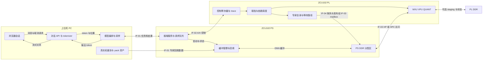
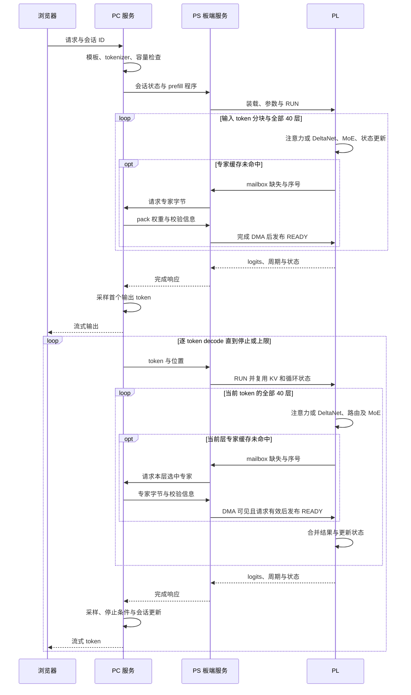
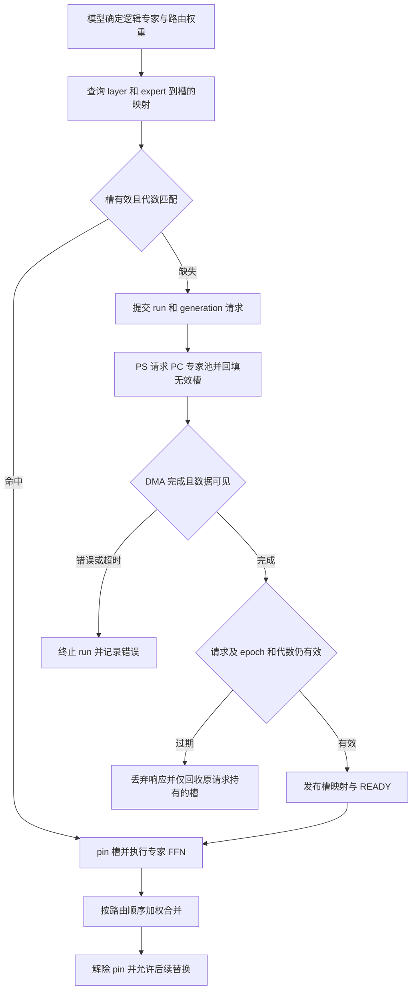
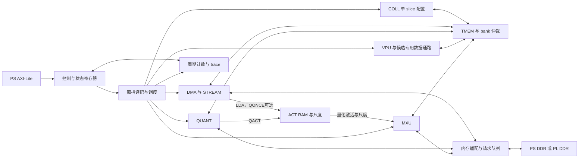
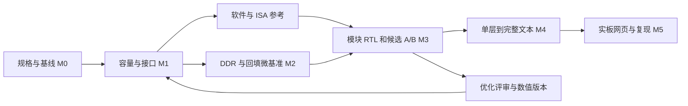

# HSA-MoE-ACC v1 顶层设计 Spec

文档版本为 v0.1，更新日期为 2026-11-18，状态为待团队评审的设计基线。本文指导 HSA-MoE-ACC v1 的模型移植、板级设计、ISA 扩展与验证迭代。文中的“拟采用”“候选”“待测”均表示本项目的设计决定或假设，验收记录用于将这些状态更新为已验证。

## 导航

- [1. 目标、需求与交付边界](#1-目标需求与交付边界)
- [2. 版本、现有资产与证据](#2-版本现有资产与证据)
- [3. 模型、容量和带宽预算](#3-模型容量和带宽预算)
- [4. 系统架构与推理时序](#4-系统架构与推理时序)
- [5. 模型算子映射](#5-模型算子映射)
- [6. PC、PS、PL 接口](#6-pcpspl-接口)
- [7. ISA 基线与扩展](#7-isa-基线与扩展)
- [8. PL 模块规格](#8-pl-模块规格)
- [9. 上游实验与研究证据](#9-上游实验与研究证据)
- [10. 优化候选与原型选择](#10-优化候选与原型选择)
- [11. 验证矩阵与验收](#11-验证矩阵与验收)
- [12. 性能观测与评估](#12-性能观测与评估)
- [13. 构建与可复现资产](#13-构建与可复现资产)
- [14. 迭代节点与决策记录](#14-迭代节点与决策记录)
- [15. 参考资料](#15-参考资料)

## 1. 目标、需求与交付边界

v1 的目标模型暂定为 `Qwen/Qwen3.6-35B-A3B`，首选硬件为单块 AMD ZCU102。使用目标模型真实权重执行完整 40 层文本路径的 prefill 与 decode，经过 PC 服务在浏览器完成多轮文本对话。首期配置提案为单用户、batch 1、上下文容量 512 token、每轮最多生成 32 token，后续根据容量和性能评审调整。上下文包括聊天模板、系统消息、历史与本轮生成，达到容量时按明确策略截断或拒绝请求。

主路线为 PC 保存完整专家池、PS 管理设备与回填、PL 执行所有文本层的专家 FFN，并争取让注意力、DeltaNet、路由、归一化及输出投影一并在 PL 执行。路线冻结时逐项批准第 5 节的执行位置。若需要 PC 分担算子，保留全模型正确性并在验收中公布实际下放范围，记录与主路线的差距及恢复条件。单层、小模型与随机权重用于阶段验证。

| 编号 | 需求与完成条件 | 检查入口 |
|---|---|---|
| REQ-01 | 固定 checkpoint revision、OpenTPU commit、量化格式和构建版本 | TEST-01、资产 manifest |
| REQ-02 | 目标真实文本权重覆盖全部 40 层、Embedding 与 LM Head | TEST-05、模型覆盖清单 |
| REQ-03 | 保持上游基础指令语义，新功能由设备能力和配置选择 | TEST-02、TEST-03 |
| REQ-04 | 目录、缓存、DMA 及 PS 物理地址映射均通过边界检查 | TEST-04、IF-02/03/04 |
| REQ-05 | 路由选中逻辑专家和结果合并顺序遵循模型及数值参考 | TEST-02/05 |
| REQ-06 | PS/PC 可处理命中、缺失、重复响应、超时和复位后的过期消息 | TEST-04/06 |
| REQ-07 | 同数值语义的 ISA、RTL 和实板输出逐位一致 | TEST-02/03/05 |
| REQ-08 | 浏览器至少两轮上下文关联对话，并能关联设备执行证据 | TEST-06 |
| REQ-09 | 分别报告 prefill、decode、回填及端到端时间，附条件 | TEST-07 |
| REQ-10 | 新增硬件以同器件、同约束、同输入完成资源与性能 A/B | TEST-03/07 |
| REQ-11 | 构建、装载、启动与验收可由另一成员依文档重跑 | TEST-08 |

性能目标、允许功耗、板端工作频率和资源余量在 M1/M2 用微基准冻结。当前没有 ZCU102 实板数据，本文不填写未经测量的吞吐承诺。性能未达目标时保留可运行交付和瓶颈记录，正确性问题优先闭环。

## 2. 版本、现有资产与证据

### 2.1 证据口径

“源码事实”指固定文件中可核实的实现，“上游记录”指项目方公开实验，“官方资料”指模型或厂商文档，“设计提案”指本文选定的实现方向，“待测”指需要本项目实验回答的问题。上游性能记录附其板卡和范围，候选机制附最小验证实验。

检索日期为 2026-11-18，近三年窗口为 2023-11-18 至 2026-11-18，文献按代表性设计用途检索。本次工作为文档核对，未连接 FPGA、重新运行真实模型或完成综合。

### 2.2 固定基线

| 资产 | 当前状态和使用方式 | 证据 |
|---|---|---|
| HSA-MoE-ACC | 从远程 main `8aae78ffe43dfd195d93a7b666f3eaaf26d98857` 创建 `docs/v1-top-level-spec` | 本地 Git 记录 |
| OpenTPU | 已导入 `third_party/opentpu/`，固定 `d84db55712aba0d40811d7762cb052f05d55b7e5`，文件树 `3c0f989c5f3ab1375471638537dc1801c34d47cc` | [S01]、[上游目录](../third_party/opentpu/) |
| 授权 | 上游 Apache-2.0；第三方生成文件与依赖各按其许可 | [LICENSE](../third_party/opentpu/LICENSE)、[THIRD_PARTY.md](../third_party/opentpu/THIRD_PARTY.md) |
| 模型 | 目标名称 Qwen3.6-35B-A3B；既有计划记录 revision `345d467b117d1fd5eda9b879a5988de9ae5f47a7`。本次核验上游随附的配置快照；固定 revision 页面获取失败，快照与该 revision 的同一性尚未确认 | [S02]、[本地配置快照](../third_party/opentpu/tools/pf500_models/Qwen3.6-35B-A3B/config.json)；资产准备时锁定全部分片/配置哈希 |
| 上游 BCU1525 | 项目方记录单卡 32 GiB、150 MHz、`bcu1525-wg:bhw16`、35B 真实权重短 decode 34.7 device tok/s，8 token/logits 与 ISA 逐位一致 | [板上记录](../third_party/opentpu/docs/bcu1525_wg.md#10-on-the-card) |
| 上游 YPCB-00338 | 项目方有 4 GiB 板存＋PC 专家流送，Qwen3.5-35B 路径可参考 | [offload](../third_party/opentpu/docs/offload.md)、[streamed.py](../third_party/opentpu/opentpu/host/streamed.py) |
| 本地网页与 ISA | 本次读取已有日志，Qwen3.5-4B 两轮得到 Paris/France，记录 `WEB_QWEN35_ISA_PASS`；这是历史证据 | 本机 `F:/OpenTPU/qwen35-4b-web-smoke.log` |
| 本地模型资产 | 本次目录可见 LFM2.5-230M、Qwen3.5-4B；35B 完整模型需另准备 | 本机 `F:/OpenTPU/models/` |
| 工具环境 | PATH 可见 Python、Git、Node、WSL 与 Vivado 2018.3；未在当前 PATH 找到 Verilator。WSL 内部版本和 EDA 授权需 M0 检查 | 本次只读环境检查 |

本机路径仅用于开发追溯，项目配置使用可覆盖的模型根目录和工具路径。团队构建不得依赖上述个人绝对路径。上游 Vivado 构建与当前 2018.3 的 SV/IP 兼容性需用最小工程先验证，冻结工具版本后再作性能比较。

目标模型固定revision的许可证文件本次未完成远程核验，不能把OpenTPU的Apache-2.0授权套用于模型资产。M0须记录模型许可证原文/哈希及其使用条件，连同tokenizer、模板与分片清单一起归档；第三方库和厂商IP继续各按自己的许可管理。

## 3. 模型、容量和带宽预算

### 3.1 模型结构与数值基线

目标按约 35B 总参数、约 3B 激活参数命名；这两个数不等于本项目部署时的权重字节数。固定上游的[模型配置快照](../third_party/opentpu/tools/pf500_models/Qwen3.6-35B-A3B/config.json)给出隐藏维度 2048、40 个文本层，其中 30 个 Gated DeltaNet 层、10 个 full-attention 层；每层 256 个路由专家选 8 个，另有一个共享专家，路由/共享专家中间维度均为 512，词表大小 248320，Embedding 与 LM Head 不共享。注意力为 16 个 Q 头、2 个 KV 头、head_dim=256；DeltaNet 为 16 个 key 头、32 个 value 头、key/value_dim=128、卷积核 4。配置与[模型构建代码](../third_party/opentpu/opentpu/llm/qwen35.py)已交叉检查；正式目标 revision 的配置、权重和 tokenizer 同一性仍为 M0 验收项 [S02]。

文本路径首期采用上游已支持的 FP32 状态/向量运算与混合低比特矩阵格式。可参考 BCU 记录的 FP4 专家、NVFP4 部分稠密投影及 INT8 LM Head，按矩阵逐项记录实际选择。`int4`、`fp4` 和 `nvfp4` 在 OpenTPU 中有各自的缩放布局，模型资产使用打包器的实际字节数。Embedding 与 LM Head 是否共享权重依配置核验，独立权重分别预算。

### 3.2 预算表与计算方法

标准 ZCU102 配置为 4 GiB PS DDR 和 512 MiB、16-bit PL DDR [S03]。两块内存分别映射和测量。PL 可经 HP/HPC 访问 PS DDR [S04]，PS DDR 同时服务系统和 CPU，实际可分配空间与带宽由板端初始化和微基准决定。

| 对象 | 预算方法 | 现阶段结论 |
|---|---|---|
| 全部模型镜像 | 读取实际 pack manifest，包含各权重、尺度和运行区 | 上游 35B 镜像 17,903 MiB 约 17.48 GiB，超出标准 ZCU102 容量；不能直接沿用全驻留布局 |
| 单个路由专家 | `3×H×F` 参数；码值＋每行/块尺度＋padding | H=2048、F=512 时为 3,145,728 参数。实际调用上游 `ExpertFormat(2048,512,128,'fp4',grp=8).nbytes` 得 1,691,648 B，即 1.61328125 MiB；纯 4-bit 码仅为 1.50 MiB |
| 全专家池 | `40×256×expert_slot_bytes` | 上述 FP4/WG8 布局为 16.1328125 GiB；尚未计共享专家、注意力、Embedding、Head 等。PC 保存完整池 |
| 当前按层缓存下限 | 上游 `Image` 要求每层 `k≤slots≤E`，40层各至少8槽 | 仅专家槽为 516.25 MiB，已超过整个 512 MiB PL DDR；还未计状态和工作区，不能只缩一个容量常量继续运行 |
| 每 token 专家读量 | `40×8×expert_slot_bytes`，逐层按实际选择统计 | 上述布局为 516.25 MiB/token 的专家权重读量估算；缓存命中减少 PC 回填，设备仍需读激活专家。全缺失时回填同量，另计协议与其他权重 |
| PC 回填量 | 各层未命中的专家实占字节之和 | 用真实 route trace 测冷、暖缓存与 P95；预测错误预取的字节另计 |
| KV Cache | FP32参考为 `10×L×2×256×2×4`；上游 INT8 K/V 带 scale 布局为 `10480×L` B | L=512 时 FP32 为20 MiB；当前 INT8/scale 布局约5.1172 MiB。正式预算还计边界对齐和各buffer生命周期 |
| DeltaNet 状态 | `30×32×128×128×bytes` | FP32 为60 MiB；ST16 为30 MiB，属于需验证的数值变体；卷积历史另约2.8125 MiB FP32 |
| Embedding、LM Head | 各 `248320×2048` 参数，独立预算 | 各 INT8 裸码约485 MiB，FP16约970 MiB；还需scale。可将查表行由PC提供，但必须单独注明设备执行边界 |
| TMEM/ACT RAM/指令 | 按 target 的字数、实际副本和 FPGA RAM 粒度核算 | 片上 BRAM 预算与 DDR 预算分开；ZU9EG 无 UltraRAM，BCU 的 URAM 配置需重映射 |
| PC 内存与磁盘 | 原始分片、pack 池、mmap/page cache、临时转换及峰值并发 | 正式准备前测 pack 峰值 RSS 和磁盘需求，避免用权重文件大小替代峰值内存 |

以上为布局计算和容量估算，没有性能实测含义。槽字节数通过本机运行上游纯布局函数核验，未生成大模型镜像。证据为 [ExpertFormat](../third_party/opentpu/opentpu/llm/moe.py)、[Image 的 slots/KV/state 布局](../third_party/opentpu/opentpu/llm/qwen35.py)和 [k_scale_bytes](../third_party/opentpu/opentpu/compiler.py)。D/WG/格式改变后必须重新计算，不能把 WG8 数字当成未来 ZCU target 的固定占用。正式预算由同一 revision 的 pack 清单覆盖，逐项登记权重、KV/状态、指令、mailbox、激活、专家槽、staging、PS系统预留与对齐损耗，分配失败显式报告缺口。

PC 回填的串行时间下界为 `miss_bytes / effective_link_bandwidth`。设备读量下界为 `device_bytes / effective_DDR_bandwidth`。等大专家时平均回填量可初估为 `40×8×(1-h)×slot_bytes`，h必须由目标路由和缓存trace取得。重叠能隐藏部分时间，最终周期由调度和竞争决定。千兆链路原始线速为125 MB/s，全缺失516.25 MiB仅传专家就至少约4.33秒/token，实际还含协议和中转；这是带假设的理论下界，不能作为板上结果。PC发送短文本与流送专家分别测量。

若走路线B，先在PS DDR建立PL可访问的专家窗口，或重构为跨层共享槽池/逐专家填充流水，再决定PL DDR是否保留热点缓存。后者须同步改编译器地址生成、runtime映射、DMA和槽生命周期。当前按层最小8槽的布局不能无修改地放入PL DDR；短上下文也不能消除16.13 GiB专家池的容量缺口。

### 3.3 三条部署路径与决策

| 路线 | 计算与存储位置 | 决策条件与交付 |
|---|---|---|
| A 全权重板上驻留 | PL 执行整网，全部模型权重位于板端 DDR | 标准 ZCU102 对当前镜像容量不成立。若更换平台或扩容，重做板级映射、容量与带宽验收 |
| B 专家按需流送，主路线 | PC 保存池，PS 管理映射/回填，PL 执行专家及目标整网算子 | pack 后的常驻数据＋状态＋工作区＋缓存能放入已分配内存；实测回填带宽/延迟支持团队接受的交互目标 |
| C PC/PL 分担，阶段原型 | PC 执行部分模型，板端执行选定专家任务或层 | 用于真实专家FFN与链路闭环，保持完整模型参考；验收逐项说明执行位置，记录恢复 B 所需资源与接口 |

M1 冻结算子位置和容量，M2 以带宽实测复审 B/C。v1 的速度目标由这些测量确定，主机 SSD 冷启动、PC page cache 热状态与板上专家缓存分别记录。

## 4. 系统架构与推理时序

### 4.1 整体数据流，设计提案

此图定义主路线的职责，实际DMA引擎和缓存策略在PS/PL内的归属于M1冻结。PC–PS可用网络建立初期链路，其吞吐通过M2决定是否需高速接口。ZCU102板载PS PCIe以Root Port接线描述，不能直接复用PC Root Complex＋BCU XDMA插卡路径；采用PCIe前须单独核实Endpoint角色、接线及驱动[S03]。

### 4.2 一次请求，设计提案

初始化权重/程序装载、prefill、decode 分别计时。首版采样置于 PC，后续可复用上游设备生成循环；每种模式的采样配置与计时边界写入运行 manifest。取消请求由 PC/PS 协调安全停止，过期响应由 session epoch 和 run ID 排除。

## 5. 模型算子映射

下表是 B 路线的目标分工，M1 评审批准后作为实现约束。C 路线变更需同步测试与日志中的实际覆盖率。

| 算子/数据 | PC/PS 职责 | PL 目标实现与数据 | 上游阅读入口 |
|---|---|---|---|
| tokenizer、聊天模板 | PC 固定模板、词表、stop token 和历史 | 接收 token ID；越界 ID 报错 | [chat.py](../third_party/opentpu/opentpu/host/chat.py) |
| Embedding | 准备独立表，或容量紧时按 token 提供一行 | FP32表行LD；INT8表one-hot＋MM gather；host表走mailbox回填，候选专用行加载/解码 | [qwen3.py](../third_party/opentpu/opentpu/llm/qwen3.py)、[qwen35.py](../third_party/opentpu/opentpu/llm/qwen35.py) |
| RMSNorm、残差 | PS 管理激活/参数布局 | VOP 归约、RSQRT、MUL、ADD，候选融合 | [kernels](../third_party/opentpu/opentpu/kernels/) |
| 全注意力、RoPE | 管理位置和 KV 存储边界 | MM、位置运算、分块 Softmax、QACT 和 P×V | [attention.py](../third_party/opentpu/opentpu/kernels/attention.py) |
| Gated DeltaNet | 保存每会话状态与复位策略 | DSTEP/STREAM 或 RDOT/OUTER 基础序列 | [qwen35.md](../third_party/opentpu/docs/qwen35.md)、[stream.md](../third_party/opentpu/docs/stream.md) |
| router 投影、Top-k | 准备 gate 权重和路由 trace | MM＋ARGMAX 淘汰循环；候选 exact TOPK | [moe.py](../third_party/opentpu/opentpu/llm/moe.py) |
| 路由权重归一化 | 保持模型 rule 和 scale | Qwen 对选中 logits 的指数/求和/缩放 | [moe.py 的 route](../third_party/opentpu/opentpu/llm/moe.py#L588) |
| 共享专家与路由专家 FFN | PC 保存专家池，PS 保证选中槽有效 | gate/up/down、SiLU/SwiGLU 和量化；共享专家 gate 单独处理 | [streamed.py](../third_party/opentpu/opentpu/host/streamed.py) |
| 加权合并 | PS 保证输出地址与专家顺序记录 | 按路由顺序缩放与累加，允许乱序执行后按规定顺序提交 | [moe.py](../third_party/opentpu/opentpu/llm/moe.py) |
| LM Head 与采样 | PC 首版采样、记录 seed/temperature | PL 词表投影，分块输出 logits 或 argmax | [qwen3.py](../third_party/opentpu/opentpu/llm/qwen3.py) |

视觉编码器、图像输入和 MTP 推测生成作为后续候选；首期目标按文本输入模式验证。不同模型的 top-k rule 和共享专家结构分别建参考。

## 6. PC、PS、PL 接口

### 6.1 接口表，设计提案

| 编号 | 接口与方向 | 数据、形状与生命周期 | 约束与完成语义 |
|---|---|---|---|
| IF-01 | PC ↔ PS 任务/资产传输 | header 含 protocol_version、request_id、session_epoch、run_id、kind、length；payload 为 token、程序、缓冲数据或专家片段 | 按请求去重；先申请缓冲再传数据；结果回显版本和 ID；错误返回结构化状态 |
| IF-02 | PS ↔ PL AXI-Lite 控制 | 原有ID/VERSION、程序地址、ARG、RUN、STATUS、CAPS、CYCLES等 | 复用偏移和语义；启动前检查前次运行、LOADING与CALIB条件。HALTED后仍等WR_IDLE及内存可见性处理才能读结果；上游没有READY状态位 |
| IF-03 | PL ↔ DDR AXI4 数据 | 程序、权重、激活、状态与 mailbox；dense device address 通过适配映射 PS/PL DDR | 字节序 little-endian；burst/地址/宽度转换由板级适配；通道 valid 遇 ready=0 保持；完成包括最后写响应 |
| IF-04 | 专家缺失与槽发布 | layer_id、expert_id、slot_id、slot_generation、run_id、字节数与完成标志 | 填充期间槽无效，DMA 完成和可见性处理后发布 READY；消费结束后解 pin |
| IF-05 | 调度器 ↔ 计算单元 | 上游cmd_t、start/rdy/done、源目标地址和mask | 保留各单元既有接受及完成边沿，一个接受对应一次完成或明确ERROR；TMEM后继依赖按原有写回语义解锁。DRAM端口接受与DDR落地分开，主机读回另等WR_IDLE |
| IF-06 | VPU/MXU/QUANT ↔ TMEM/ACT | 读地址/使能、返回数据、写地址/掩码、gnt、ren/rhold | 保留原参数下读返回时序和重放语义；更改延迟时用外壳适配并更新回归 |
| IF-07 | PC 服务 ↔ 浏览器 | `/v1/chat/completions` 风格消息、SSE token、停止/错误信息 | 会话历史容量受模型 cap 控制；对话事件带 request_id；实板后端失效报告错误并释放会话资源 |

IF-01 首版为可分片传输的请求/响应协议，具体 framing 和驱动实现于 M1 定稿。长权重分片使用 payload length、offset 与 checksum，重试同一片段不重复提交。CPU 指针不作为 PL 总线地址；由板端内存分配返回句柄、device offset、physical segment 和长度。

IF-02的ZCU实现需要重新定义现有CALIB位与实际内存路径的映射：PS DDR可用性来自系统初始化及驱动分配就绪，PL DDR来自MIG初始化状态；未启用通道不得伪装成可访问存储。沿用上游寄存器偏移的同时，通过板型/配置区分适配语义，M1冻结加载顺序及各状态位的产生、清除和错误条件。若新增派生READY状态，独立分配并文档化，不按已有状态位读取。

### 6.2 地址、对齐和一致性

DRAM 以 byte 寻址，TMEM 以 32-bit word 寻址，指令固定 32 bytes，TMEM FP32 数据保存原始位模式。MXU/QACT 具体布局按 D、格式、WG、通道 hash 和 pack 配置确定，descriptor 同时记录数据区、尺度区与 stride。按基线要求检查对齐及范围 [S05]。

PS DDR 的物理可见区与 OpenTPU 密集设备地址空间分离。板级适配用显式 segment 表映射，核验高地址窗口、AXI 地址位宽及 MMU/DMA 映射。32-bit device offset 仅用于选定的低于 4 GiB 密集空间，涉及更大空间则更新 AW 配置和全部转换；不得截断 PS DMA 地址。具体 base/size 在取得板端分配结果后冻结。

逻辑布局包括程序区、I/O 与 mailbox 区、稠密权重区、KV/状态区、激活工作区、专家槽和 staging。每区记录起止、权限、对齐、所有者和最大需求，包含越界及互相覆盖检查。PS 系统与应用保留空间排除在 PL arena 外。

首版在 Linux 下使用驱动分配的 DMA 可用缓冲，明确 coherent 或 streaming DMA 属性。HP 路径按 non-coherent 处理并通过 DMA API 转移所有权；选择 HPC 时还要核验 AXI 属性、CCI 和软件配置后才能宣称一致性。CPU 提交前完成 sync/flush，接收前完成 invalidate/sync，READY 发布与控制 doorbell 使用恰当的屏障。PL 写入数据、最后响应和完成标志顺序通过 IF-03/04 回归。

### 6.3 专家缓存命中与缺失，设计提案

每个槽只在refcount=0且没有未完成DMA时可替换。tag核对与pin必须原子化，避免查中后被替换。并发相同专家缺失合并为一个请求，多个消费者等其完成。槽生命周期为EMPTY→FILLING→READY→IN_USE→READY，替换时先失效再更新generation。完成后核对run_id、epoch、expert_id及generation，再发布映射；旧响应不得发布READY或释放新generation持有的槽。

host/PS 回填侧先保持上游 ExpertServer 的基线语义。增加 generation 等机制时同步修改模型程序、目录布局和仿真 host hook，使用协议版本区分。命中优先调度可以隐藏等待，但加权结果按固定顺序合并以保留数值行为。

超时后停止发新任务，待已接受 AXI 事务完成/隔离，再使运行失效并复位计算状态。重新开始请求使用新 epoch 并重建必要 KV/DeltaNet 状态。部分失败的层不得直接追加为已提交会话位置。

## 7. ISA 基线与扩展

### 7.1 基础编码与支持范围

指令由 `w0..w7` 八个32-bit word组成。`w0`字段为opcode[7:0]、ra[11:8]、rb[15:12]、rc[19:16]、rd[23:20]、flags[31:24]；w1～w7的含义随opcode定义，不能统一当成七个地址。配置含16个AW-bit寄存器，R0读零，AW由target决定。LI/ADDI的立即数为`{w2,w1}`再按AW截取；普通基址＋offset按2^AW取模。程序/部分控制地址仍有低4 GiB限制，按[S05]逐项检查。

| opcode | 基线指令 | v1 使用及依赖 |
|---|---|---|
| 0x00、0x01 | NOP、HALT/CHAIN | 停止/程序链；HALT为core完成，主机读回另等WR_IDLE及可见性处理 |
| 0x02、0x03 | LI、ADDI | 标量地址/循环参数，AW 位宽处理一致 |
| 0x04、0x05 | LOOP、BAR | 控制流与 slice 同步；首板 S=1 仍验证合法用法 |
| 0x06、0x07 | RLD、WAITW | 动态索引、地址、目录和回填等待 |
| 0x10、0x11 | LD、ST | DDR/TMEM连续n个32-bit word搬运；分段/跨行步长由地址生成及循环组织 |
| 0x12、0x13 | DSTEP、STREAM | DeltaNet/状态流；能力存在时使用，参考序列用于对照 |
| 0x14 | LDA | QACT ST 后复用已量化激活，QONCE 能力可选 |
| 0x20 | MM | MXU 矩阵计算；WF、ACC、RMAX、ASCALE 等按原语义 |
| 0x21、0x22 | QACT、QST | ACT RAM/DDR 量化，布局与尺度按 pack 格式 |
| 0x30 | VOP | 向量运算、归约、ARGMAX、OUTER、复合函数及可选融合 |
| 0x40 | GATHER | 多 slice 候选，首板能力由 target 宣告 |

VOP 的 func、广播方式和 stride 按上游定义。当前已有 ADD/SUB/RSUB/MUL/MAX/MIN/OUTER、COPY、EXP2、RECIP、RSQRT、ABS、FILL、EXP2SUB、LOG2、RSUM、RMAX、RSSQ、RDOT、ARGMAX，以及按能力启用的 SIGMOID、SILU、MAC。复合函数的舍入边界、FTZ、符号零、NaN 和归约顺序以 ISA/fp32.py 为数值参考。

### 7.2 扩展路线

| 接入形式 | 适合变化 | 兼容及工程影响 |
|---|---|---|
| 微架构优化 | 重定时、缓冲、访存仲裁、算子内部复用 | 指令结果一致时 ISA 参考沿用，周期变化通过 RTL/实板评估 |
| VOP 子功能/可选模式 | TOPK、RMSNorm 等有限参数操作 | 复用 U_VPU 与 TMEM 端口，扩 func 译码、能力位与依赖范围 |
| 独立 opcode/执行单元 | profile显示并行释放VPU有收益 | 扩目前DMA/MXU/QUANT/VPU/COLL五类分派、等待项编码、完成状态、端口仲裁和计数器；选非WAITC变体时同时更新其依赖检测 |

首轮保留 8-word 长度，候选名作为文档标识，具体 opcode/func/flag 编码于实现 PR 再核对未占用位并登记。上游 CAPS 已有大量定义，新能力在自有版本区分的能力寄存器中分配，避免覆盖已用位。参数超出七个 word 的候选可使用版本化 descriptor，完整登记 descriptor 本身及数据区 footprint。

### 7.3 候选指令契约，设计提案

| 候选 | 输入输出与 baseline | 拟定语义和数值约束 | 依赖/能力 |
|---|---|---|---|
| EXT-TOPK | FP32 logits `[R,E]`→分数 `[R,k]` 与索引 `[R,k]`；对照 ARGMAX/RLD/FILL/COPY k 次 | 首轮 E=256,k=8；排序/平局、-0/+0 与特殊值规则沿用 ARGMAX；索引为现有 RLD 可消费格式，两个输出区分别给 stride | 读输入，写两个输出范围；与输入重叠先拒绝或完整预读后提交，具体由模块 Spec 定案；无能力时生成旧序列 |
| EXT-EMBED | token ID `[R]`＋独立表/尺度→FP32/量化行`[R,H]`；按实际格式对照FP32行LD、INT8 one-hot＋MM gather、host表mailbox路径 | token越界ERROR，固定词表/row stride/format；独立表和tied head情况分别核验 | 读ID、读表、写输出；动态表区保守覆盖并在wait checker中一致 |
| EXT-RMSNORM | `[R,H]`、gamma、epsilon→`[R,H]`，可选量化写出；对照 RSSQ、RSQRT、MUL | `x * rsqrt(sum(x²)/H + eps) * gamma` 的原有运算顺序与精度；改变归约或近似算法需新数值版本 | 读 x/gamma，写 y/尺度；量化融合还写 ACT/scale；原地写需符合读前写后 |
| EXT-SOFTMAX | 首选 attention 的 EXP+SUM 或量化入口融合；路由 k 项保持既有序列 | attention 使用已有 block max、sum、alpha 与 P×V 流程；一般行归一化与该模式分开定义 | 记录输出向量、行和与后续量化的依赖；对全部被mask行及空行明确测试 |

当前Qwen路径从E个路由专家logits中取Top-k，再对选中logits做稳定Softmax。共享专家不参加这次Top-k及归一化；其输出乘独立sigmoid门控后相加。打包router矩阵的第E行可存共享gate logit，不能当成一个路由专家。其他模型可能先sigmoid、加bias选专家，再取未加bias分数作权重。[固定源码](https://github.com/FeSens/openTPU/blob/d84db55712aba0d40811d7762cb052f05d55b7e5/opentpu/llm/moe.py#L909-L1000)是数值依据。首版TOPK保留选择和归一化两个步骤，融合另行评审。

新增指令的未知/不支持编码在模拟器和实板均返回错误，能力关闭时编译器选择已支持序列。基础程序与扩展程序分别标 required_features；host 核验设备 Config、数值版本、寄存器映射及内存布局。纯 timing 参数记录 build manifest，涉及程序行为的参数进入兼容性哈希。格式切换后旧会话状态/缓存资产需重新验证或重新生成。

### 7.4 联动修改检查单

| 层次 | 必须审查的上游入口 |
|---|---|
| 指令、函数、数值参考 | [isa.py](../third_party/opentpu/opentpu/isa.py)、[isasim.py](../third_party/opentpu/opentpu/isasim.py)、[fp32.py](../third_party/opentpu/opentpu/fp32.py) |
| 语言与编译、模型调用 | [language.py](../third_party/opentpu/opentpu/language.py)、[compiler.py](../third_party/opentpu/opentpu/compiler.py)、llm/kernels |
| 依赖范围与动态访问 | [waits.py](../third_party/opentpu/opentpu/waits.py)、[otpu_pkg.sv](../third_party/opentpu/rtl/top/otpu_pkg.sv)、[otpu_seq.sv](../third_party/opentpu/rtl/seq/otpu_seq.sv) |
| 设备与构建选择 | [target.py](../third_party/opentpu/opentpu/target.py)、targets、板级 Tcl、host `device_config/check_fits` |
| 验证与 profile | test_vops、test_rtl、host/opchecks、trace/parser/Lens，新增功能的元数据映射 |

写两块输出、内部提前读取、可延迟写出的新功能必须在Python与RTL依赖描述里一致。现有footprint结构允许4个读区间、3个写区间，覆盖TMEM/DRAM/ACT；新功能超出时须保守合并或扩结构，不能漏掉索引、尺度或descriptor。

WAITC模式由编译器对动态寄存器作保守抽象执行，生成每条指令64-bit等待项，RTL按计数和VPU掩码等候，运行时不再逐条比较地址区间。遗漏等待不会被后备footprint scoreboard补救。[waits.py](../third_party/opentpu/opentpu/waits.py)中的Checker必须参与新指令回归。非WAITC变体仍按其硬件footprint逻辑验证。依赖解除后还要经过TMEM端口仲裁；DMA/COLL/VPU/MXU/QUANT请求的整组授予规则和rhold/RPL重放保持一致，不能只拿到部分端口便消耗其余输入。

## 8. PL 模块规格

候选 TOPK/RMSNorm/Embedding/Softmax 第一轮接入 VPU/QUANT 或 DMA 的既有边界，独立执行单元在 profile 支持后再变更此图。

| 模块编号 | 功能与上游边界 | v1 参数、风险与验证 |
|---|---|---|
| HW-01 board shell | PS AXI-Lite、PS/PL DDR master、复位时钟、IRQ/轮询；参考 rtl/shell | ZCU102 新 board top，AXI 位宽/地址/响应核验，TEST-04 |
| HW-02 SEQ/IMEM | 原有取指、LOOP/CHAIN、依赖和完成状态 | 首版S=1；窗口/IMEM按编译长度选，WAITC等待项与所选非WAITC依赖模式分开测试，不能假定两者同时补救 |
| HW-03 MXU | 低比特解码、整数累加、尺度与 epilogue/drain | WG/MCOLS/ACT_ROWS 按带宽和资源缩放；DSP48E2 技术层复用；TEST-02/03 |
| HW-04 VPU | FP32 向量、归约、ARGMAX、OUTER 与复合函数 | 保留现有端口和时序语义；小步替换内部数据通路，TEST-02/03 |
| HW-05 QUANT/ACT | QACT/QST、激活/尺度管理 | pack 与硬件格式逐位对照；QONCE/融合能力按 target，避免增加全局副本 |
| HW-06 TMEM | 多 bank 临时数据、仲裁、写回与重放 | 采用 BRAM 可实现配置，评估 IMPL3 的重放/双端口；与复制式基线 A/B |
| HW-07 DMA/SE | 批量搬运、DSTEP/STREAM 状态处理 | burst 长度与 PS port 限制匹配；读写重排、最后响应与回压测试 |
| HW-08 expert mapping | 目录/mailbox、cache slot 与缺失等待 | 首版保留上游软件管理；generation 和 pinning 在适配层实现，TEST-04/05 |
| HW-09 observability | 周期、busy、访存、回填、错误与 trace | 先迁移上游计数器，按功能扩展分类，测 trace 丢失并记录资源开销 |

时钟提案以单一 PL core domain 起步，首个综合探索点为 100 MHz；PS AXI 和 DDR 独立时钟按板级 IP 约束连接。跨域使用异步 FIFO 或已核验 AXI 转换器，复位异步条件进入各域后同步释放。TMEM/MXU 倍频为候选，需要独立 generated clock、CDC 和最小脉宽检查。时钟使能优先采用 FPGA CE；功耗预算由实测和约束共同制定。

资源预算覆盖 LUT/FF/DSP/BRAM、AXI/IP shell 和 debug。ZU9EG 的约 274K LUT、2520 DSP、32.1 Mb BRAM、无 URAM [S06] 仅是总上限，M2 综合后给每模块预算和时序余量。每个候选以同 target、同约束测增量，布线密度/高扇出进入评审。

上层显式端口可继续复用，内部 SV interface 由候选模块自行选用并通过工具兼容检查。替换边界由信号契约决定。RTL 文件选择由统一配置和文件列表解析，Verilator、OOC 与整板综合记录同一候选 ID；不靠手工复制覆盖多套文件。

### 8.1 模块交接与不变量

以下为模块Spec需要继承的顶层契约。数据位宽、队列深度、读返回拍数及资源分配由统一target导出，M1/M2填写实际数值；当前不虚构尚未综合的单模块预算。新增内部流水级可改变完成延迟，不能改变未协商的外部采样拍或副作用。

| 模块 | 主要输入→输出 | 参数、缓冲与交接检查 |
|---|---|---|
| HW-01 shell | AXI-Lite事务、DDR AXI响应→控制、native memory响应/IRQ | 地址宽度/数据宽度、HP/HPC/MIG时钟；CDC和复位域表；AXI ID/错误传播；未完成事务复位隔离；按板级自检交付 |
| HW-02 SEQ | 指令与等待项、ARG、单元状态→cmd/start、HALT/ERROR | S、AW、IMEM、窗口与WAITC配置；指令/等待项容量同步；禁止忽略未知opcode；完成计数无丢失/重复 |
| HW-03 MXU | ACT码值/尺度、DRAM权重/尺度→TMEM结果 | D、MCOLS、WG、流FIFO、chunk/尾部掩码；整数累加、块缩放、epilogue舍入；drain未完成不得复用仍占用的上下文 |
| HW-04 VPU | cmd、TMEM操作数→TMEM向量/归约/索引 | LANES、函数能力、归约槽、请求/写回FIFO；随机回压下数据稳定；变延迟按事务对齐；共享SE资源仲裁一起回归 |
| HW-05 QUANT/ACT | FP32行/模式→ACT码与scale，或QST DRAM数据 | ACT_ROWS、D、split/QONCE模式；格式和scale字节数固定；与LDA及MXU读端口冲突依赖明确 |
| HW-06 TMEM | 各客户成组读写请求→gnt、返回值与写入 | TMEM words、bank/sub-bank、IMPL/RPL/TDP/PMP；保留整组全授予/全不授予、ren/rhold、回放及读写碰撞语义；不能用IMPL2作可综合基线 |
| HW-07 DMA/SE | LD/ST/LDA/DSTEP/STREAM及DDR响应→TMEM/ACT/状态写回 | burst/FIFO、流宽度、ST16/SE_OWN；末尾长度、响应回压和地址窗口；DMA完成、WR_IDLE和数值状态分别观察 |
| HW-08 expert mapping | 逻辑expert ID、miss与传输完成→有效槽/恢复许可 | 槽数、目录/tag、generation、pin/refcount；软件元数据不等同新增片上硬件；命中/缺失/过期与取消有对应参考轨迹 |
| HW-09 trace/CSR | 分派/开始/完成/访存事件→计数快照与trace | counter位宽、trace depth/filter/drop；跨域读值一致性、溢出规则和事件定义；不由增加观测改变被测时序而不记录 |

每个模块交付至少附接口信号表、时序图、参数/数值版本、可变延迟说明、缓冲上界、复位恢复约束、定向测试、随机压力测试及同约束资源报告。未填写项列入M1/M3评审，不能默认为零开销或无边界。

## 9. 上游实验与研究证据

### 9.1 上游试验线清单

状态来自固定版本源码和 docs；同一实验的结论只适用于所记录配置。

| 主题 | 入口 | 已有状态与约束 | 对本项目的用途 |
|---|---|---|---|
| MXU MX 格式、DSP 打包 | [mx_mxu.md](../third_party/opentpu/docs/mx_mxu.md)、[weight_groups.md](../third_party/opentpu/docs/weight_groups.md)、rtl/exp/mx_mxu | 主线 otpu_mxu 使用精确整数累加/共享 epilogue；WG 的 DSP48E2 packed PE 已进入 BCU 路径；exp 原型与主线需分别读 | 复用技术单元与数值测试，降低 WG/缓存适配 ZU9 |
| MXU 倍频 | [wide_mxu.md](../third_party/opentpu/docs/wide_mxu.md)、rtl/exp/pump_us、targets 的 wmx | WMX数值RTL仿真逐位通过，但无pump版bitstream；文中100 MHz布局布线失败，150 MHz未启动，b2未构建 | 探索DSP/带宽平衡，达到资源/时钟条件后复评，不引用模拟吞吐作为板上收益 |
| VPU 倍频/扩宽 | [vpu_pump.md](../third_party/opentpu/docs/vpu_pump.md)、rtl/exp/vpu_pump | lane 原型与 OOC 已做；上游 YPCB 研究显示整体收益有限且整VPU倍频时序困难 | 先做瓶颈上界，比较局部融合与加宽的收益/成本 |
| TMEM 单副本/重放 | [tmem_nocopy.md](../third_party/opentpu/docs/tmem_nocopy.md)、rtl/exp/tmem_nocopy、rtl/mem/otpu_tmem.sv | 当前BCU/YPCB目标已选择IMPL3单副本、2×泵、RPL/TDP/GST；早期“未集成”说明只描述当时实验起点。IMPL2是不可综合的仿真模型 | ZU9EG无URAM，需重做BRAM预算；独立co-sim/OOC数据不能代替ZCU实测 |
| TMEM 泵与端口 | [tmem_pump.md](../third_party/opentpu/docs/tmem_pump.md)、rtl/exp/tmem_pump | 有独立试验，部分功能已由 IMPL3 参数实现，不能整体等同板上能力 | 比较省 RAM 与仲裁/时钟代价 |
| SEQ、footprint、wait entries | [seq_vpu.md](../third_party/opentpu/docs/seq_vpu.md)、rtl/exp/seq_vpu、opentpu/waits.py | 当前BCU/YPCB已启用SEQ_WC；编译器生成64-bit等待项，RTL按计数/掩码等待。不能假定另有硬件区间scoreboard补救遗漏等待 | 新指令联动离线footprint、等待项编码、RTL完成事件与checker |
| 指令缓存、FSUM | [icache.md](../third_party/opentpu/docs/icache.md)、[targets.md](../third_party/opentpu/docs/targets.md) | 对应实验variant有RTL/模拟记录，不代表production默认打开 | 缓解程序容量及行和访存，分别测fetch miss、列数约束与控制开销 |
| 专家缓存/执行重排 | [offload.md](../third_party/opentpu/docs/offload.md)、[host/streamed.py](../third_party/opentpu/opentpu/host/streamed.py)、[host/offload.py](../third_party/opentpu/opentpu/host/offload.py) | YPCB 有真实模型流送记录；hits-first、cache policy、预取评估分别记录 | 主路线最相关；PC–PS 链路需重新校准 |
| 跨层预取 | offload.md 第15节，特别15.3 | LES/Fate类预测在该路径因窗口短、DRAM竞争等被关闭，未建RTL | ZCU重评须有不同链路/缓存条件的证据，同时测浪费流量和需求miss等待 |
| expert-major prefill/QONCE | [tiled_prefill.md](../third_party/opentpu/docs/tiled_prefill.md)、[quant.md](../third_party/opentpu/docs/quant.md)、moe.py | 多种编译/硬件能力处于不同验证状态，按 target 开关查 | 多 token 复用专家权重；首期 batch1 decode 完成后评估 |
| Softmax/GLU/归一化数据流融合 | [dataflow.md](../third_party/opentpu/docs/dataflow.md)、[deltanet_chunk.md](../third_party/opentpu/docs/deltanet_chunk.md) | 已有VSIG及可选FSUM；QACT/QST前端NORM/ROPE/GLU/EXP+SUM的fold方案明确为next-release提案 | 分清已实现与拟建路径，先测TMEM往返和兼容风险 |
| STREAM/DSTEP、SE共享 | [stream.md](../third_party/opentpu/docs/stream.md)、[BCU target](../third_party/opentpu/targets/bcu1525-wg.toml) | 当前BCU已开STREAM/DSTEP，OUTER关闭，DeltaNet使用DSTEP；文档旧草案标签不代表当前无实现 | 按目标选择独立SE或VPU共享路径，核对归属DMA的依赖与完成行为 |
| KV/状态精度 | isa.md ST16、formats/quant、targets | 部分 e6m9 状态在 BCU 已用；精度改变影响模型轨迹 | 优先用与目标模型匹配的校验确定格式，再记配置与资产版本 |

上游曾认为 k≤8 的 ARGMAX 淘汰足以完成 Top-k [offload.md 第5.2节](../third_party/opentpu/docs/offload.md#52-control-the-card-routes-the-host-serves)。这构成现有基线，是否增加 TOPK 应由新平台实测的路由关键路径和资源预算决定。GLU/Softmax 的 VPU 内部占比不能替代其整网占比；读取性能研究时核对分母及驻留/流送假设。

### 9.2 近期论文和开源实现

以下七项按原始论文、出版方/作者页面及公开仓库核验，用于选择候选机制。没有运行其工程。FPGA直接MoE工作主要面向视觉模型；表中的可迁移方法尚未在本项目目标上验证，性能不能横向直接比较。同组的UbiMoE、CoQMoE、MoE-Sched存在研究延续关系。

| 工作、发表状态 | 分类、模型与平台 | 可核实机制和公开资产 | 本项目借鉴与限制 |
|---|---|---|---|
| R01 UbiMoE，ISCAS 2025 | FPGA MoE直接研究；M³ViT，ZCU102/U280，batch1 | 流式注意力核＋复用线性核，融合Softmax、双缓冲、参数搜索；[官方HLS/host/testbench](https://github.com/DJ000011/UbiMoE) | 借鉴按算子选择数据流和资源搜索；视觉patch与语言decode工作集不同。论文工具2023.1与仓库U280说明2022.1有差异 |
| R02 CoQMoE，Euro-Par2025，在线2025-08-23，出版方引文年2026 | FPGA MoE直接研究；M³ViT/Cityscapes/U280 | 硬件友好的量化重参数化与计算编排；[仓库](https://github.com/DJ000011/CoQMoE)主要为Quant_algorithm，完整硬件说明引用UbiMoE | 借鉴量化与数据流协同；不是OpenTPU现有MX格式的直接替代，也不是独立完整RTL工程 |
| R03 MoE-Sched，TVLSI在线2025、34(1):104–117(2026) | FPGA MoE直接研究；M³ViT-tiny；本次未完整核实板卡/精度 | 核内流水、模块复用与跨die映射协同；原文访问受限，未核实独立完整仓库 | 借鉴核间/存储/物理实现一起调度；跨die机制不直接适用于ZU9EG。未核实字段保持空缺 |
| R04 FlightLLM，FPGA2024 | 可迁移FPGA LLM；U280上板，VHK158软件仿真 | 低比特/稀疏计算、混合精度、映射编译及片上中间数据复用；[工件](https://github.com/FlightLLM/flightllm_test_demo)含上板与profile目录 | 借鉴MXU利用率、长度感知编排与非线性单元；不能把VHK158仿真当实测，“on-chip decode”也不等于全部权重在片上 |
| R05 FlexLLM HLS，arXiv:2601.15710v1，2026-01-22预印本 | 可迁移FPGA LLM；Llama-3.2-1B/U280，V80为投影 | prefill/decode定制、参数化模块组合；[官方仓库](https://github.com/Crazy-James26/FlexLLM)有Modules与阶段配置 | 借鉴统一模块接口及阶段映射；HLS核接TMEM/完成事件仍需适配。不同于NSDI2026同名GPU共服务项目 |
| R06 Fiddler，ICLR2025 | CPU/GPU MoE软件参考，非FPGA | 资源感知异构编排，比较计算位置与权重搬运；[官方仓库](https://github.com/efeslab/fiddler) | 用PC计算专家与流送后PL计算做成本比较；CPU fallback的算子与比例要公开记录 |
| R07 Fate，WWW2026；早期预印本2025 | CPU/GPU edge offload软件参考，非FPGA | 跨层gate预测、缓存与I/O编排；[作者链接仓库](https://github.com/FFFzy/Fate_open)，有expert_ARC_cache.py等 | 只预测预取，不改变真实路由；结合上游关闭预取的反例，测有效预取/浪费字节/争用/P95后再选用 |

上述工作提供迁移思路，没有证据表明其现成实现已经完成Qwen3.6-35B-A3B在ZCU102上的部署。Softmax融合有直接原图/方法依据；Embedding与当前Qwen RMSNorm专用核在本组文献中缺少可直接插入的实现，其候选依据主要来自当前源码profile与访存分析。

窗口外奠基性补充为Edge-MoE（ICCAD2023，会议2023-10-28至11-02），涉及M³ViT及视觉MoE部署。它早于本次滚动三年起点，不计入七项。TeraMAC未核实到与本任务相符的现代FPGA LLM项目，未作为设计证据。

## 10. 优化候选与原型选择

所有方向均为研究候选，最终采用以目标 trace、RTL A/B 和实现报告为依据。资源预算包含存储和控制，独立执行单元还计入新端口、队列、计数器及验证工作量。

| 方向 | 瓶颈证据 | 参考依据 | ISA影响 | RTL/接口变化 | 资源和数值代价 | 最小实验 | 采用条件 | 建议阶段 |
|---|---|---|---|---|---|---|---|---|
| OPT-01 专家回填/缓存 | 35B池超板存，先测miss等待 | offload；Fate/Fiddler | 首轮沿用WAITW/RLD | PS cache policy、批量回填、命中优先与槽映射 | staging/槽竞争/预取浪费/DDR干扰 | 真实route冷暖回放＋DMA微基准 | miss bytes与P95改善，端到端收益成立且专家选择不变 | 首轮候选原型 |
| OPT-02 exact TOPK | 多次ARGMAX及标量依赖，关键路径占比待测 | moe.py；上游k≤8足够的反例 | 优先VOP子功能＋回退 | 小缓冲/比较器流式top8，双输出footprint | LUT/索引状态/Fmax/tie规则 | E256,k8单/多token，指令/TMEM/周期A/B | 整层实际收益超过资源/验证代价 | 首轮二选一原型 |
| OPT-03 RMSNorm＋量化 | RSSQ/RSQRT/MUL到QACT中间访存 | kernels/lib；dataflow提案 | 候选VOP/QUANT模式 | 统计＋缓冲或重读缩放，量化接口联动 | BRAM/重复读/归约顺序与漂移 | H2048真实layout，位精确/误差版分测 | TMEM流量下降且整核时间/资源满足预算 | 首轮二选一原型 |
| OPT-04 Embedding搬运 | 单token只取一行，位置/格式决定开销 | qwen3.py实际gather | 先布局，必要时EXT-EMBED | 地址生成、行缓存与解码 | cache SRAM/随机访问/host等待 | FP32 LD、INT8 one-hot＋MM、host回填三基线 | 单行与整token等待确有可见改善 | 后续研究 |
| OPT-05 Attention EXP+SUM＋量化 | 当前RMAX/EXP2SUB/FSUM与TMEM流量 | attention/dataflow；UbiMoE | 可选融合能力，明确数值版本 | Softmax到QUANT路径，保留block max/sum/alpha | exp资源/缓存/mask/全mask边界 | 不同L与prefill行数，P×V/状态/周期A/B | 先证明注意力段受限，且端到端收益成立 | 后续研究 |
| OPT-06 专家FFN/GLU/MXU | 小矩阵利用率、带宽及padding | mx_mxu/WG；FlightLLM/CoQMoE | 首选不改ISA；格式变体另版 | WG/分块/DSP打包、SiLU×up融合 | DSP/布线/精度/格式耦合 | gate/up/down真实形状，有效MAC/字节/单层时间 | 非单纯外存受限；映射能满足资源与Fmax | v1基础映射＋候选 |
| OPT-07 TMEM与端口 | ZU9无URAM、bank冲突与重放 | TMEM3主线及tmem实验 | 保留语义 | BRAM单副本/双端口/分bank与适量泵频 | replay延迟/hot bank/时钟难度 | 同程序随机回压/并发，复制基线A/B | 容量成立；RAM节省与周期/时序代价可接受 | v1基础适配 |
| OPT-08 调度/指令缓存 | footprint/window/fetch占比待profile | waits/seq/icache；MoE-Sched | 基础指令不改；等待项同步变更 | 队列/完成计数/缓存/仲裁 | 控制/BRAM/RAW-WAR-WAW遗漏 | 随机依赖压力＋整层profile | 正确性和可复现端到端收益同时成立 | 后续研究 |
| OPT-09 Prefill分组/状态复用 | token分散和DeltaNet状态往返 | tiled_prefill/QONCE；FlexLLM | 优先既有指令与编译模式 | expert-major/chunked状态调度与缓冲 | TTFT/工作集/路由聚类开销 | 真实route、不同prompt块，专家并集/流量/精度 | TTFT、吞吐与缓存容量的折中符合目标 | decode闭环后 |
| OPT-10 精度/状态协同 | 权重池、KV/循环状态流量 | ST16；CoQMoE/FlightLLM | 显式独立numeric/format版本 | 分矩阵量化、状态压缩、尺度布局 | 路由近并列/模型质量/打包兼容 | 固定校验集、logits/路由/质量/pack字节 | 误差门限先评审且质量与整网收益通过 | 后续独立精度版 |

首轮建议以 OPT-01 的链路/缓存原型作为主线，以 OPT-02、OPT-03 二选一作为专用指令原型，另同步完成 OPT-07 的板级基础配置。M2 的关键路径数据决定二选一结果。若回填占主要暴露时间，计算单元候选先保留测量与数值原型，资源优先满足缓存和搬运闭环。

优化上限采用 Amdahl 初筛 `S=1/((1-p)+p/s)`，p 是候选在关键路径上的可消除占比。Roofline 用有效算力、有效DDR带宽和实际字节数，双流量需加入 PC 链路和状态读写。没有测量的 p/s/带宽写为变量或假设。周期缩短但 Fmax 降低时，以 `cycles / implemented_frequency` 再比较。

## 11. 验证矩阵与验收

### 11.1 分层验证

| 测试编号 | 内容与输入 | 通过条件 | 关联模块与现有入口 |
|---|---|---|---|
| TEST-01 资产/模型 | checkpoint配置、模板、量化pack、目标字节布局 | revision/hash一致，目标矩阵/层齐全，bounds和格式匹配 | REQ-01/02；quant.py、llm/image、配置检查 |
| TEST-02 数值 | 单指令、随机边界、真实中间张量；含-0/+0、极值、特殊值 | 同语义与ISA逐位一致；误差版按评审标准 | HW-03/04/05；test_vops.py、test_fp_rtl.py、host/opchecks.py |
| TEST-03 RTL/接口 | 基线候选的事务对齐、连续发射、队列、随机ready、依赖压力 | 写地址/数据/次数和完成顺序正确，无死锁，预期周期差可解释 | HW-02/03/04/06/07；test_rtl.py、test_se_vpu.py |
| TEST-04 板级/缓存 | 地址窗口、跨burst边界、DDR压力、缺失/重复/过期回填、超时 | 读回校验、单次有效发布、无越界，旧代响应被排除，错误可恢复 | IF-01/02/03/04；板端新测试配合上游selftest |
| TEST-05 单层/整网 | 真实专家和目标完整文本路径，prefill/decode与第二轮 | 同输入、精度和顺序下ISA/RTL/板端关键状态及logits一致，目标层覆盖完整 | REQ-02/05/07；模型reference、single-layer与短decode |
| TEST-06 网页/恢复 | 两轮中英文对话、停止、容量溢出、掉线、设备复位 | 上下文有效，request与run可关联；后端失效报告错误；新会话可恢复 | IF-01/07、REQ-08 |
| TEST-07 性能/资源 | 固定条件的单算子、层、整网A/B和冷暖缓存 | 输出准确，报告cycles/Fmax/流量/资源/尾延迟；对照相同条件 | REQ-09/10、HW-09 |
| TEST-08 复现 | 独立成员从固定源码准备资产并启动 | 构建、装载和演示可重复，版本与日志齐全 | REQ-11、M5 |

计时变更按事务完成对齐；外部固定拍数依赖仍需满足接口契约。特别覆盖最后写回被回压、done提前、mask尾部、地址别名、reset时未完成AXI和RPL重放。trace中的输出正确不能替代这些定向检查。

### 11.2 模型正确性与误差版本

第一层参考为官方模型实现的固定checkpoint，用于核验模型数学、模板、位置及权重加载；第二层为使用相同量化格式和算子语义的ISA gold，用于RTL逐位验证。原始FP32模型和量化模型的差异单独报告。

对每层选取 norm 输出、router logits、专家索引/权重、专家输出、KV/DeltaNet 状态和最终 logits 定位首个偏差。近并列路由输入纳入测试，不能仅凭生成文本相同判断位精确。采样先用greedy固定流程，再用固定seed验证指定随机采样；跨平台随机实现明确记录。

如候选改变归约顺序、指数近似或状态精度，提出 `abs_error <= atol + rtol*abs(ref)`、logits KL/Top-1、路由一致率及固定样本质量指标的阈值，M3之前由团队按参考误差与用途冻结。其正确性以新数值Spec验证，基础位精确回归继续保留。

## 12. 性能观测与评估

CYCLES 与 CORE_KHZ 计算设备运行时间，SNAP 同拍锁存MXU/VPU/DMA/QUANT busy、TMEM deny、DRAM读写与等待。增加明确的专家命中/缺失、回填字节、等待周期和超时计数，条件计数只反映其定义覆盖的事件。

硬件trace的 dispatch/start/end与源码/编译元数据关联层、算子和专家。一个Softmax含多条指令，按PC/source归组；不同单元时间区间重叠，busy不能直接相加。报告算子延迟、资源占用区间、暴露等待以及总时间，关键路径收益由A/B整段周期确认。trace容量、drop和覆盖范围写入profile，长运行总计数＋代表窗口结合。

| 手段 | 用途与边界 |
|---|---|
| ISA | 计算、读写和同步语义，统计指令/字节；其运行墙钟与解析profile不作为FPGA周期 |
| RTL/Verilator | 真实RTL时钟、并行、握手、仲裁与模型内存响应；固定带宽或理想模型的结果注明假设 |
| ZCU板级模型 | 以实际PS/PL DDR、AXI宽度、读延迟、burst限制、竞争与回填轨迹校准 |
| 实板 | 实际设备cycle、DDR/链路与状态，计算时钟满足布局布线约束；工具估算功耗与测量功耗分列 |
| PC/浏览器 | checkpoint/pack装载、模板、服务排队、网络、采样、首token和请求完成时间 |

基准矩阵至少含 prefill/decode、两种上下文、冷/暖缓存、命中/缺失和多组输入。首轮建议上下文128与512作为设计测试点，目标容量调整后更新。报告中位数和P95，样本数、预热、频率、工具、数值格式、请求及生成长度随表附出。设备RUN中的WAITW可包含回填等待，PC端统计避免把重叠时间重复相加。

上游 `tools/perf_qwen.py`、`opentpu.lens`、`host/hwlens.py` 和 `tools/moe_prefill_cosim.py` 是复用入口；35B和ZCU102的实际入口需适配。某些MoE工具用零权重/已驻留专家测计算，不能用该配置推断完整权重流送速度。板上读写微基准先校准，再用代表层和真实trace缩小长仿真的成本 [S07]。

## 13. 构建与可复现资产

仓库使用现有 docs、rtl、boards/zcu102、host、web、configs、tools、tests 与 third_party/opentpu。上游快照固定，后续补丁标明来源和改动范围。顶层配置解析候选文件与依赖，仿真、OOC、整板都打印实际源码和参数；构建缓存包含内容、参数和工具版本。

建议 manifest 字段为 source_commit、upstream_commit、model_revision、tensor/pack hashes、target、required_features、numeric_version、ISA版本、地址映射版本、runtime/PS镜像/驱动版本、工具版本、时钟与资源、采样配置、会话容量。示例字段是设计提案，M1冻结schema。

工具链基线先在 Windows/WSL 检查可用性，RTL仿真沿用WSL/Linux的Verilator流程，Vivado按已核验版本构建。目录和环境路径参数化。构建产物、波形、大权重和运行日志进入制品存储，源码仓库保留生成脚本和摘要/哈希。许可证、第三方归属和新增改动说明随分发资产保留。

## 14. 迭代节点与决策记录

| 节点 | 输入与交付 | 通过条件和依赖 | 建议责任角色 |
|---|---|---|---|
| M0 基线 | 本Spec、版本/资产列表、需求矩阵 | 目标范围明确，模型与工具版本可定位 | 架构负责人＋模型/验证成员 |
| M1 预算/接口 | 实际pack清单、地址/缓冲表、算子分工、协议和错误状态 | 容量成立，依赖明确；B/C选择写入决策 | 架构、模型、存储、板级协作 |
| M2 微基准 | 寄存器自检、DDR/DMA与PC链路测试、校准模型 | 数据正确且吞吐/延迟可解释，确定交互目标与资源预算 | 板级、存储、验证 |
| M3 模块原型 | 基础RTL回归及2～3项候选的Spec/数值/综合/周期报告 | 数值/事务通过，性能和资源同条件A/B，失败有首个偏差记录 | 各模块主责＋独立复核 |
| M4 层到整网 | 真实单层、短decode、完整40层/会话状态对照 | 覆盖清单齐全、实际执行位置明确；命中/缺失均正确 | 模型、RTL、验证联调 |
| M5 网页实板 | bitstream、PS镜像、脚本、manifest、两轮演示与性能记录 | TEST-01～08证据齐全，可由另一成员复现 | 集成负责人＋独立验收 |

现有九人工程计划继续作为人员分配依据；本Spec按模块和接口交接，具体排期在预算评审后更新。容量不足先核对pack/常驻/工作区，回填慢先查miss字节/请求粒度/链路/DDR争用，数值差异定位首层首算子，时序失败按关键路径和约束检查逐项缩减并行或重定时。

| 决策编号 | 日期与状态 | 决定和依据 | 待验证及复评条件 |
|---|---|---|---|
| DEC-01 | 2026-11-18，提案 | 固定OpenTPU d84db55，保留8-word ISA | M0核对模型与工具；更新上游另做兼容回归 |
| DEC-02 | 同日，提案 | PC权重池＋PS回填＋PL专家为主线 | M1/M2预算与真实trace不支持时先交付C并记录恢复B条件 |
| DEC-03 | 同日，提案 | 首轮OPT-01＋TOPK/RMSNorm二选一，TMEM作为基础适配 | 关键路径占比和资源测量后确认或改序 |
| DEC-04 | 同日，提案 | 基础数值优先位精确，近似优化独立版本 | 新数值误差门限在M3前评审，路由变化纳入质量检查 |
| DEC-05 | 同日，待定 | PC–PS初期网络，最终权重链路待M2 | 比较有效吞吐与miss_bytes；高速接口需板卡接线/驱动证据 |
| DEC-06 | 同日，待定 | PS DDR分配、地址段与PL缓存规模 | Linux/裸机模式、可用容量、AXI实测与pack字节确定后冻结 |
| DEC-07 | 同日，待定 | 工作频率、功耗、时延和吞吐目标 | 最小综合及微基准完成后给值，原始报告进入制品 |

### 14.1 本次文档检查与后续检查

本次进行源码/资料只读核对、相对路径和导航检查、Markdown结构检查及Git变更范围检查。5张Mermaid图使用Mermaid12.3.0解析通过，未执行浏览器图形排版验收；实际显示大小随Markdown查看器调整。RTL回归、综合、时序、功耗和实板测试作为M2～M5交付项。35B资产尚需准备，当前网页日志仅证明历史4B ISA路径。评审优先确认路线B/C完成边界、DDR分配、PC链路和首轮候选。

## 15. 参考资料

所有网络来源访问日期为2026-11-18。上游源码证据固定到d84db55，项目内链接相对本文路径；本地计划/日志属于开发证据，后续迁移为版本化验收记录。

- [S01] FeSens. [openTPU 固定提交](https://github.com/FeSens/openTPU/tree/d84db55712aba0d40811d7762cb052f05d55b7e5)，[项目许可](../third_party/opentpu/LICENSE)与[第三方许可](../third_party/opentpu/THIRD_PARTY.md)。用于实现与上游验证范围。
- [S02] Qwen. [Qwen3.6-35B-A3B 官方模型卡](https://huggingface.co/Qwen/Qwen3.6-35B-A3B)、[候选固定revision配置](https://huggingface.co/Qwen/Qwen3.6-35B-A3B/blob/345d467b117d1fd5eda9b879a5988de9ae5f47a7/config.json)。用于模型形状、路由及许可，准备资产时再次锁定。
- [S03] AMD. [ZCU102 Evaluation Board User Guide，UG1182 v1.7](https://docs.amd.com/api/khub/documents/rt6tROKcAceWoROXFPMY5w/content)。用于板载PS/PL DDR、接线和接口。
- [S04] AMD. [Zynq UltraScale+ PS，PG201 的 Slave Interface](https://docs.amd.com/r/en-US/pg201-zynq-ultrascale-plus-processing-system/Slave-Interface)。用于HP/HPC路径与一致性条件。
- [S05] FeSens. [ISA v1](../third_party/opentpu/docs/isa.md)、[固定版本ISA文档](https://github.com/FeSens/openTPU/blob/d84db55712aba0d40811d7762cb052f05d55b7e5/docs/isa.md)、[target与技术层](../third_party/opentpu/docs/targets.md)。用于指令、数值和能力。
- [S06] AMD. [Zynq UltraScale+ MPSoC Overview，DS891](https://docs.amd.com/api/khub/documents/sbPbXcMUiRSJ2O5STvuGNQ/content)。用于ZU9EG资源。
- [S07] FeSens. [Observability](../third_party/opentpu/docs/observability.md)、[Lens](../third_party/opentpu/docs/lens.md)、[MoE prefill co-sim](../third_party/opentpu/tools/moe_prefill_cosim.py)。用于计数、trace与仿真假设。

- [R01] Jiale Dong 等. *UbiMoE: A Ubiquitous Mixture-of-Experts Vision Transformer Accelerator With Hybrid Computation Pattern on FPGA*. ISCAS2025. [DOI/出版记录](https://doi.org/10.1109/ISCAS56072.2025.11043956)，[作者原文](https://arxiv.org/html/2502.05602v1)，[源码](https://github.com/DJ000011/UbiMoE)。直接视觉MoE；本文未复现。重点为计算核复用、Softmax融合、搜索，未将其性能移植为Qwen结论。
- [R02] Jiale Dong 等. *CoQMoE: Co-Designed Quantization and Computation Orchestration for Mixture-of-Experts Vision Transformer on FPGA*. Euro-Par2025，LNCS15901:60–74，出版方引文年2026. [Springer](https://link.springer.com/chapter/10.1007/978-3-031-99857-7_5)，[预印本](https://arxiv.org/abs/2506.08496)，[源码](https://github.com/DJ000011/CoQMoE)。硬件友好量化；公开资产范围见第9节。
- [R03] Jiale Dong 等. *MoE-Sched: Enabling Efficient FPGA Deployment of Mixture-of-Experts Vision Transformers via Coordinated Scheduling*. IEEE TVLSI34(1):104–117，2026，在线2025-09-08. [DOI](https://doi.org/10.1109/TVLSI.2025.3604705)，[IEEE](https://ieeexplore.ieee.org/document/11153520/)。正文获取受限，细部平台/精度与独立代码未核实。
- [R04] Shulin Zeng 等. *FlightLLM: Efficient Large Language Model Inference with a Complete Mapping Flow on FPGAs*. FPGA2024. [DOI](https://doi.org/10.1145/3626202.3637562)，[作者原文](https://arxiv.org/html/2401.03868v2)，[官方工件](https://github.com/FlightLLM/flightllm_test_demo)，[发布归档](https://zenodo.org/records/10461718)。U280上板与VHK158软件仿真分别记录。
- [R05] Jiahao Zhang、Zifan He、Nicholas Fraser、Michaela Blott、Yizhou Sun、Jason Cong. *FlexLLM: Composable HLS Library for Flexible Hybrid LLM Accelerator Design*. [arXiv:2601.15710v1](https://arxiv.org/abs/2601.15710v1)，2026-01-22，预印本；[官方仓库](https://github.com/Crazy-James26/FlexLLM)。正式发表渠道本次未确认。同名GPU项目见[NSDI2026官方页](https://www.usenix.org/conference/nsdi26/presentation/oliaro)，两者分别引用。
- [R06] Keisuke Kamahori、Tian Tang、Yile Gu、Kan Zhu、Baris Kasikci. *Fiddler: CPU-GPU Orchestration for Fast Inference of Mixture-of-Experts Models*. ICLR2025. [正式proceedings](https://proceedings.iclr.cc/paper_files/paper/2025/hash/8cd1ce03ea58b3d7dfd809e4d42f08ea-Abstract-Conference.html)，[官方仓库](https://github.com/efeslab/fiddler)。CPU/GPU参考，未声称FPGA复现。
- [R07] *Fate: Fast Edge Inference of Mixture-of-Experts Models via Cross-Layer Gate*. WWW2026. [DOI](https://doi.org/10.1145/3774904.3792527)，[作者页面](https://lvyufeng.github.io/publication/2026-04-13-Fate)，[预印本v2](https://arxiv.org/html/2502.12224v2)，[作者提供的源码](https://github.com/FFFzy/Fate_open)。正式/预印本作者列表有差异，本文按版本分别链接；迁移分析结合OpenTPU offload第15.3节的反例。
- [R08，窗口外] *Edge-MoE: Memory-Efficient Multi-Task Vision Transformer Architecture with Task-Level Sparsity via Mixture-of-Experts*. ICCAD2023. [IEEE](https://ieeexplore.ieee.org/document/10323651/)，[作者原文](https://arxiv.org/abs/2305.18691)。仅作奠基补充，不计入2023-11-18之后的文献。
